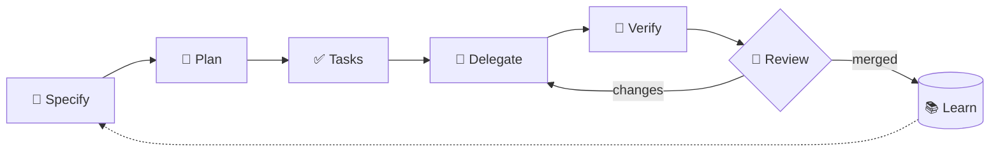

  <picture>
    <source media="(prefers-color-scheme: dark)" srcset="./docs/images/header-dark.svg">
    
  </picture>

### 🤖 What I do now

I used to write most of my code myself. Now I design the **systems that let coding agents write it well**:
**specs before code** · **skills, not prompts** · **delegation with guardrails** · **memory that lasts**.

### 🛠️ Things I'm building

- 🐚 **Nautilus** *(private)*: an agent-driven dev workflow. It specs, plans, and delegates changes, and logs every decision.
- 🏮 [**ai-lantern**](https://github.com/manuelstolze/ai-lantern): agent skills for technical spikes and evidence-backed research.
- 🧠 [**cortex-baseline**](https://github.com/manuelstolze/cortex-baseline): a Markdown second brain and developer memory for agents.
- 🧩 **pi-integrations** *(private)*: extensions and skills for the Pi coding agent.

### 🧰 Toolbox

### 📫 Reach me

