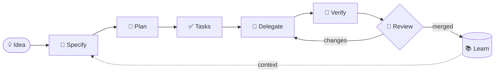

  <picture>
    <source media="(prefers-color-scheme: dark)" srcset="./docs/images/header-dark.svg">
    
  </picture>

  
  
  

---

### 🤖 What I do now

I used to write most of my code myself. Now I design the **systems that let coding agents write it well**.

I care about the parts that make agents reliable:

- **Specs come before code.** Every change gets a specification, a plan, and a task list. A human approves each one.
- **Skills, not prompts.** I write reusable agent skills and workflows that encode how I want work done.
- **Delegation with guardrails.** I hand approved tasks to implementation agents in isolated worktrees. Lint, types, and tests act as gates.
- **Memory that lasts.** I keep knowledge bases and logbooks so agents (and I) remember why decisions were made.

### 🔁 My agent loop

### 🛠️ Things I'm building

| Project | What it is |
| --- | --- |
| 🐚 **Nautilus** *(private, in progress)* | A modular, agent-driven development workflow. A *Bridge* drafts specs, plans, and tasks with me and delegates the work. A *Logbook* tracks every change, *Charts* map my repositories, and a *Library* keeps what I've learned. |
| 🏮 [**ai-lantern**](https://github.com/manuelstolze/ai-lantern) | A workspace for technical spikes. Agent skills research, map systems, and write evidence-backed drafts. |
| 🧠 [**cortex-baseline**](https://github.com/manuelstolze/cortex-baseline) | Cortex, a Markdown second brain and developer memory system driven by agent skills. |
| 🧩 **pi-integrations** *(private)* | Extensions and skills for the Pi coding agent, published as independent npm packages, including a Jira integration. |

### 🧰 Toolbox

**Agentic:**

**Foundations:**

### 💬 Ask me about

Spec-driven development with agents, writing agent skills, multi-agent delegation, and keeping humans in the loop. Full-stack React and Java also still count.

### 📫 Reach me

<code>$ agent status</code> → <i>always learning, always delegating 🤖</i>

